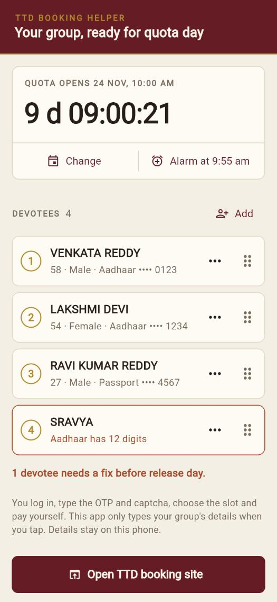

# TTD Booking Helper

When TTD releases the month's darshan quota, slots go in minutes. You're on the phone typing four or five devotees' names (exactly as on their ID), ages, genders and 12-digit Aadhaar numbers while the timer runs. This app keeps your group ready, and while you book on the **official TTD site** it types each detail into the box you tap.

Android. No account, no ads. Your group's details stay on the phone.



<sub>Screenshot uses sample devotees.</sub>

## How it works

1. **Before release day:** add each devotee with their name as printed on the photo ID, age, gender, ID type and number. Aadhaar numbers are checked for 12 digits, and a wrong one is flagged in red. Drag to set the order.
2. **Set the release time** from TTD's announcement. The countdown runs on the home screen. *Alarm at 9:55 am* opens your clock app with an alarm already set five minutes before.
3. **On release day:** tap *Open TTD booking site*. The official site (`ttdevasthanams.ap.gov.in`) opens inside the app with your group in a tray at the bottom. Log in, pick the date and slot, then:
   - **tap a box on the page, then tap a chip** (for example *2. Lakshmi · Age*) and the value is typed into that box; or
   - tap **Fill all rows** to fill the devotee rows in order, best effort. Check every row against the IDs.
4. Payment: UPI and bank links open in your own UPI or bank app, the same as in a phone browser.

## What it does not do

- **It does not log in, type OTPs, solve captchas, pick slots, press Book or pay.** You do all of that. It never clicks a button on the page.
- It refuses to type into captcha, OTP, password, PIN, card or UPI ID boxes.
- **It is not linked to TTD.** It is a convenience for your own booking on TTD's own site. Always book only on the official site, never through agents.
- It doesn't know the release dates. TTD announces them, and you enter them here.
- *Fill all rows* matches boxes by their labels. TTD can change its pages at any time, so if it fills nothing, use the chips, which work on any form.

## Your data

Names, ages and ID numbers are saved in the app's private storage on this phone, and nowhere else. On screen, ID numbers show only their last four digits. Uninstalling the app deletes everything.

## Permissions

| Permission | Why |
|---|---|
| Internet | To load the official TTD site inside the app. |
| Set alarm | To hand the alarm time to your clock app. The alarm lives in your clock app. |

## Build

```bash
flutter pub get
flutter test                # model, countdown, payment-link handling, screens
npm install && npm test     # the script that types into the page, tested on a mock devotee form
flutter build apk --release
```

APKs are attached to [Releases](https://github.com/ChandraChaan/ttd-booking-helper/releases) when a `v*` tag is pushed. They are signed with the debug key, so Android will ask you to allow installing from outside the Play Store.

## Project layout

| Path | What it holds |
|---|---|
| `lib/src/model.dart` | Devotees, ID masking and checks, countdown, `intent://` to `upi://` conversion. |
| `lib/src/home_page.dart` | Countdown, alarm, the devotee list. |
| `lib/src/booking_page.dart` | The official site in a WebView and the chip tray. |
| `assets/fill.js` | Injected into the page: remembers the box you tapped, types into it, or fills rows by label. Never clicks. |
| `test-js/` | jsdom tests for `fill.js` on a made-up devotee form. |

## License

MIT. Copyright (c) 2026 Chandra ObulaReddy.
